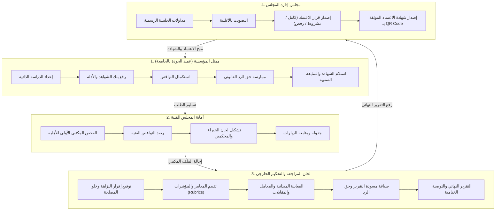

# دليل المستهدفين والسيناريوهات التفصيلية والصلاحيات
## نظام مجلس الاعتماد الأكاديمي وضمان جودة التعليم العالي - الجمهورية اليمنية

---

## 📑 نظرة عامة
يوثق هذا الملف الفئات المستهدفة في النظام وفق نموذج **الفصل الصارم بين الصلاحيات ومنع تعارض المصالح (Strict Role-Based Access Control - RBAC)**؛ حيث يعمل كل طرف ضمن نطاق صلاحياته الحصرية فقط، دون أي تداخل في الأدوار بين المؤسسة المقيمة ولجان التحكيم وأمانة المجلس ومجلس الإدارة.

---

---

## 🏛️ المستهدف الأول: ممثل المؤسسة التعليمية / عميد مركز التطوير وضمان الجودة

* **الصفة في النظام**: `INSTITUTION_OFFICER`
* **الحساب التجريبي للاختبار**: `sanaa_quality` (أ.د. هدى العماد - جامعة صنعاء) / كلمة المرور: `caqa123456`
* **النطاق المسموح به (Scope)**: جامعتها وكلياتها وبرامجها التابعة لها فقط (لا يحق لها الاطلاع على ملفات أي جامعة أخرى).

### 📋 جدول الصلاحيات:
| الصلاحيات الحصرية الممنوحة | الإجراءات الممنوعة والمحجوبة عنه نهائياً |
| :--- | :--- |
| • إنشاء وتحديد مسار طلب الاعتماد (مؤسسي / برامجي). • تعبئة وتحرير تقرير الدراسة الذاتية (SSR). • رفع وتصنيف وحذف الشواهد في بنك الأدلة. • تسليم التقرير رسمياً وإغلاقه. • استلام ملاحظات الفحص المكتبي ورفع النواقص. • التنسيق اللوجستي للزيارة الميدانية. • ممارسة **حق الرد القانوني** على مسودة التقرير. • استعراض وتحميل شهادة الاعتماد فور صدورها. • تقديم خطة التحسين المستمر والتقارير السنوية. | ❌ إجراء أو تعديل الفحص المكتبي الأولي. ❌ تشكيل أو تعيين أعضاء لجنة المحكمين. ❌ تعبئة استمارة التقييم المعياري وسلالم التقدير (Rubrics). ❌ تسجيل معاينات المعامل أو محاضر المقابلات الميدانية. ❌ صياغة تقرير المراجعة الخارجية أو وضع التوصية. ❌ حضور جلسات مجلس الإدارة أو التصويت. ❌ إصدار قرارات الاعتماد أو توقيع الشهادات. |

### 🎬 السيناريو العملي الواقعي لممثل الجامعة:
1. **التقدم وبدء الدراسة**: يسجل عميد الجودة دخوله، ويضغط على "تقديم طلب اعتماد جديد"، ويختار نوع المسار (مثلاً: اعتماد برامجي - بكالوريوس الطب والجراحة).
2. **إعداد التقرير الذاتي**: يدخل على نموذج الدراسة الذاتية (SSR)، ويدون أسماء اللجان الداخلية، والملخص التنفيذي، ونقاط القوة، والتحديات.
3. **رفع بنك الشواهد**: ينتقل إلى "بنك الأدلة"، ويرفع اللوائح والمناهج، ويربط كل وثيقة بالمؤشر الوطني الخاص بها (مثل: مصفوفة نتاجات التعلم، سجلات المستشفيات...).
4. **التسليم الرسمي**: يضغط على "تسليم التقرير رسمياً للأمانة الفنية للمجلس"؛ فيُغلق التقرير ضد أي تعديل وينتقل للمرحلة 2.
5. **معالجة النواقص**: يستلم إشعاراً بنتيجة الفحص المكتبي، وإذا طُلب منه استكمال شواهد إضافية، يظهر له زر مباشر لرفع النواقص المطلوبة.
6. **ممارسة حق الرد القانوني**: بعد انتهاء الزيارة الميدانية، يستلم إشعاراً بصدور مسودة التقرير، فيقوم بكتابة رد وتوضيحات الجامعة حيال أي أخطاء مادية أو سوء فهم للأرقام.
7. **استلام الشهادة والمتابعة**: فور صدور قرار مجلس الإدارة، يدخل ليجد شهادة الاعتماد الوطنية الرسمية جاهزة للطباعة مع رمز الـ QR Code الخاص بها، ثم يرفع خطة التحسين المستمر وتقارير المتابعة السنوية.

---

## ⚖️ المستهدف الثاني: أمانة المجلس الفنية / الإدارة العامة للاعتماد

* **الصفة في النظام**: `COUNCIL_SECRETARY`
* **الحساب التجريبي للاختبار**: `council_sec` (د. أحمد المتوكل - أمانة المجلس) / كلمة المرور: `caqa123456`
* **النطاق المسموح به (Scope)**: كافة الطلبات المقدمة من جميع الجامعات الحكومية والأهلية على مستوى الجمهورية.

### 📋 جدول الصلاحيات:
| الصلاحيات الحصرية الممنوحة | الإجراءات الممنوعة والمحجوبة عنه نهائياً |
| :--- | :--- |
| • مراجعة ودراسة ملفات التقديم والدراسة الذاتية والشواهد. • تعبئة واعتماد **استمارة الفحص المكتبي الأولي** (المرحلة 2). • تحديد نسبة اكتمال الملفات وقائمة النواقص الإلزامية. • اتخاذ القرار الإجرائي (مستوفٍ، وجود نواقص، غير مستوفٍ). • إصدار قرار **تشكيل وتكليف لجنة المراجعة والتقييم الخارجي** (المرحلة 3). • اختيار رئيس الفريق والمحكمين والمقرر من سجل الخبراء الوطني. • التنسيق لجدول ومواعيد الزيارة الميدانية. • إحالة التقرير النهائي المعتمد إلى مجلس الإدارة. • متابعة تقارير التحسين السنوية وتكليف لجان الزيارات الاستطلاعية. | ❌ تعديل نصوص الدراسة الذاتية نيابة عن الجامعة. ❌ حذف أو إضافة شواهد نيابة عن الجامعة. ❌ تقييم المعايير والمؤشرات نيابة عن لجنة المحكمين المستقلة. ❌ التصويت على منح قرار الاعتماد النهائي كعضو مجلس إدارة. |

### 🎬 السيناريو العملي الواقعي لأمانة المجلس:
1. **استقبال الطلب**: يدخل أمين عام المجلس/المسؤول الفني على لوحة التحكم، فيجد طلباً جديداً مُسلماً من إحدى الجامعات.
2. **تنفيذ الفحص المكتبي**: يفتح "استمارة الفحص المكتبي"، ويتأكد من الوثائق الشكلية والتنظيمية (الترخيص، قرارات الإنشاء، توصيف المقررات)، ويحدد نسبة الاكتمال (مثلاً: 85%).
3. **البت في الأهلية**:
   - إذا وجد نقصاً، يسجل "قائمة النواقص المطلوب استكمالها" ويختار حالة "وجود نواقص"، فيصل إشعار فوري للجامعة.
   - إذا كان الملف مكتملاً، يختار "مستوفي الشروط" ويضغط حفظ، لينتقل الطلب للمرحلة 3.
4. **تشكيل لجنة المحكمين**: يدخل على نموذج تشكيل اللجنة، ويسجل رقم وتاريخ القرار الوزاري، ويختار من القائمة رئيس الفريق (خبير متخصص في المجال)، وخبير الجودة، والمقرر، ويصدر أمر التكليف الرسمي.
5. **إحالة الملف للمجلس**: يتابع مراحل الزيارة الميدانية والتقرير النهائي، وفور اعتماده من المحكمين، يدرج الطلب في جدول أعمال جلسة مجلس الإدارة القادمة.

---

## 🔍 المستهدف الثالث: رئيس وأعضاء فريق التقييم والمراجعة الخارجية (المحكمون المستقلون)

* **الصفة في النظام**: `EXTERNAL_REVIEWER`
* **الحساب التجريبي للاختبار**: `reviewer_lead` (أ.د. علي الخولاني - رئيس فريق المحكمين) / كلمة المرور: `caqa123456`
* **النطاق المسموح به (Scope)**: يقتصر وصوله حصراً على **الطلب والبرنامج المكلف بتحكيمه رسمياً** بموجب قرار التشكيل (لا يرى طلبات أو أعمال لجان أخرى).

### 📋 جدول الصلاحيات:
| الصلاحيات الحصرية الممنوحة | الإجراءات الممنوعة والمحجوبة عنه نهائياً |
| :--- | :--- |
| • التوقيع الإلكتروني على **إقرار النزاهة وخلو المصلحة**. • فحص الدراسة الذاتية وبنك الأدلة الرقمي للمؤسسة. • تعبئة **استمارة التقييم المعياري ومطابقة الشواهد (Rubrics)** لكل مؤشر وطني (من 0 إلى 3) مع تدوين نقاط القوة والضعف. • استخدام **منصة إدارة الزيارة الميدانية** لتوثيق: &nbsp;&nbsp;أ) معاينة المعامل والقاعات ومستشفيات التدريب. &nbsp;&nbsp;ب) محاضر مقابلات الطلاب وأعضاء التدريس وأرباب العمل. &nbsp;&nbsp;ج) فحص وتدقيق نماذج الامتحانات وأعمال الطلاب والكنترول. • كتابة واعتماد مسودة التقرير التفصيلي وإرسالها للجامعة. • مراجعة ودراسة رد الجامعة (حق الرد). • صياغة التقرير النهائي المعتمد وتحديد التوصية الختامية للمجلس. | ❌ إجراء الفحص المكتبي الأولي للطلب. ❌ تشكيل أو تعديل أعضاء لجنته. ❌ تعديل أو حذف أي وثيقة رفعتها الجامعة. ❌ تعديل أو مصادرة حق الرد القانوني للمؤسسة. ❌ إصدار القرارات الوزارية أو توقيع شهادات الاعتماد. |

### 🎬 السيناريو العملي الواقعي للمحكّم الخارجي:
1. **استلام التكليف والنزاهة**: يسجل الخبير دخوله، فيجد إشعاراً بتكليفه رئيساً أو عضواً في لجنة تحكيم برنامج أكاديمي، ويؤكد إقرار النزاهة وخلو تعارض المصالح.
2. **دراسة الملف المعمقة**: يتصفح تقرير الدراسة الذاتية وبنك الأدلة إلكترونياً قبل موعد النزول الميداني.
3. **التقييم المعياري (Rubrics)**: يفتح استمارة التقييم، ويمنح كل مؤشر درجة استيفاء (0: غير مستوفى، 1: جزئي، 2: كافٍ، 3: متميز)، ويسجل الملاحظات والشواهد.
4. **تنفيذ الزيارة الميدانية**: أثناء تواجده في الجامعة، يستخدم النظام لتوثيق:
   - معاينات المعامل ومراكز المحاكاة والسعة ومطابقة شروط السلامة.
   - نتائج المقابلات الفردية والجماعية مع الطلاب وهيئة التدريس والخريجين وأرباب العمل.
   - عينات الامتحانات المفحوصة وسلالم التصحيح ومطابقة مخرجات التعلم.
5. **صياغة التقرير وحق الرد**: يكتب مسودة التقرير، ويرسلها عبر النظام للمؤسسة، وبعد استلام رد الجامعة وإيضاحاتها، يناقش الرد مع أعضاء فريقه ويثبت التعديلات في التقرير النهائي.
6. **رفع التوصية الختامية**: يحدد التوصية (منح كامل 5 سنوات، اعتماد مشروط، أو تأجيل/رفض) ويرفع التقرير النهائي رسمياً إلى مجلس الإدارة.

---

## 👑 المستهدف الرابع: مجلس إدارة المجلس / أصحاب القرار الوزاري

* **الصفة في النظام**: `BOARD_MEMBER`
* **الحساب التجريبي للاختبار**: `board_member` (أ.د. خالد الحكيمي - عضو مجلس الإدارة) / كلمة المرور: `caqa123456`
* **النطاق المسموح به (Scope)**: الاطلاع على التقارير النهائية المكتملة لكافة الجامعات والبرامج، وإدارة جلسات المداولة وقرارات الاعتماد الوطنية.

### 📋 جدول الصلاحيات:
| الصلاحيات الحصرية الممنوحة | الإجراءات الممنوعة والمحجوبة عنه نهائياً |
| :--- | :--- |
| • الاطلاع على التقرير الفني النهائي المرفوع من لجان المحكمين. • فتح وإدارة **جلسة مداولات مجلس الإدارة**. • تسجيل الحضور الرسمي لأعضاء المجلس. • التصويت الرسمي على منح الاعتماد (تسجيل الأصوات المؤيدة والمعارضة). • إصدار القرار الرسمي المعتمد: &nbsp;&nbsp;1) **منح الاعتماد الكامل (5 سنوات)**. &nbsp;&nbsp;2) **منح الاعتماد المشروط / المؤقت (1-2 سنة)** مع الاشتراطات التصحيحية. &nbsp;&nbsp;3) **تأجيل أو رفض الاعتماد** مع بيان الأسباب القانونية. • اعتماد وإصدار **شهادة الاعتماد الوطنية الرسمية الرقمية** وتوليد رمز التحقق السريع (QR Code). • البت في تقارير الزيارات الاستطلاعية الرقابية وقرارات التجديد أو السحب. | ❌ التدخل في الدرجات المعيارية التخصصية التي وضعها المحكمون في سلم التقدير. ❌ إجراء الزيارات الميدانية بدلاً عن لجان الخبراء المتخصصين. ❌ تعديل تقارير الدراسة الذاتية للجامعات. |

### 🎬 السيناريو العملي الواقعي لعضو مجلس الإدارة:
1. **استعراض الملف المرفوع**: يدخل عضو المجلس على الطلب المعروض، ويقرأ الملخص التنفيذي للتقرير النهائي وتوصية المحكمين.
2. **انعقاد الجلسة والمداولة**: يضغط على "جلسة مداولات وتصويت وقرار المجلس"، ويسجل رقم الجلسة وتاريخها وحيثيات المداولة القانونية.
3. **التصويت والقرار**: يدون أصوات الأعضاء الحاضرين (مثلاً: 9 أصوات مؤيدة، 0 معارضة)، ويختار القرار (منح الاعتماد الكامل).
4. **إصدار الشهادة الفورية**: يحدد مدة السريان (5 سنوات)، ويضغط "اعتماد وإصدار وثيقة القرار والشهادة"؛ فيقوم النظام تلقائياً بـ:
   - إصدار القرار الوزاري الرسمي برقم وتاريخ رسمي.
   - توليد وثيقة الشهادة الفاخرة للجمهورية اليمنية ومجلس الاعتماد الأكاديمي.
   - توليد رمز التحقق السريع المشفر (**QR Code**) ورقم القيد بالسجل الوطني.
   - نقل الطلب تلقائياً إلى المرحلة 7 (المتابعة السنوية المستمرة).

---

## 🌐 المستهدف الخامس: الجمهور الخارجي وسوق العمل والطلاب (بدون تسجيل دخول)

* **الصفة في النظام**: `PUBLIC`
* **النطاق المسموح به**: مقيد تماماً بصفحة التحقق الإلكترونية اللحظية فقط.

### 📋 الدور والصلاحيات والسيناريو:
1. **مسح الكود (QR Scanning)**: يقوم الطالب، أو ولي الأمر، أو مسؤول التوظيف في مستشفى أو شركة، أو الملحقية الثقافية بسفارة أجنبية بمسح كود الـ QR الموجود على شهادة الاعتماد بواسطة الهاتف الذكي.
2. **التحقق الفوري**: يفتح له الرابط العام المباشر بدون طلب اسم مستخدم أو كلمة مرور، ليعرض له بيانات الشهادة الرسمية المؤكدة من قاعدة بيانات المجلس المركزية:
   - اسم المؤسسة والبرنامج الأكاديمي المعتمد.
   - رقم القيد في السجل الوطني للاعتماد.
   - رقم وتاريخ القرار الوزاري الصادر بالمنح.
   - مدة سريان الشهادة من تاريخ كذا إلى كذا.
   - **الحالة القانونية للشهادة**: (سارية المفعول ✅ / أو ملغاة أو مسحوبة ❌).

---

## 🛠️ المستهدف السادس: مدير النظام التقني ومسؤول أمن المعلومات (System Administrator / Superuser)

* **الصفة في النظام**: `ADMIN` / `is_superuser`
* **الحساب التجريبي للاختبار**: `admin` / كلمة المرور: `admin123`
* **النطاق المسموح به (Scope)**: الوصول الفني والتقني الشامل للبنية التحتية للبيانات، إدارة سجلات المنظومة، وتهيئة النظام التشغيلي (دون التدخل في الآراء الأكاديمية التخصصية).

### 📋 جدول الصلاحيات:
| الصلاحيات الحصرية الممنوحة | الإجراءات الممنوعة والمحجوبة عنه أخلاقياً وقانونياً |
| :--- | :--- |
| • إنشاء وتفعيل وتعديل حسابات المستخدمين وصلاحياتهم. • ربط مسؤولي الجودة بالجامعات والكليات المعتمدة رسمياً. • اعتماد وتسجيل المقيمين في "سجل الخبراء الوطني" وإدخال أرقام شهادات الاعتماد. • إدارة دليل الجامعات اليمنية (حكومية/أهلية) والكليات والبرامج وقرارات إنشائها. • تهيئة وتحديث المعايير الوطنية الثمانية والمؤشرات وسلالم التقدير (Rubrics). • إدارة السجل الوطني للشهادات الصادرة وتفعيل قرارات السحب والإلغاء (Revocation). • مراقبة سجل العمليات والأمان (Audit Logs) والنسخ الاحتياطي. • صيانة النظام وفك تعليق الطلبات في الحالات الطارئة. | ❌ تعديل درجات التقييم أو أحكام المحكمين على البرامج الأكاديمية. ❌ كتابة أو تحريف الدراسة الذاتية للجامعات. ❌ التصويت بدلاً من أعضاء مجلس الإدارة أو التوقيع بدلاً عنهم. ❌ إفشاء سرية التقارير غير المعلنة قبل صدور القرار الرسمي. |

### 🎬 السيناريو العملي الواقعي لمدير النظام (Admin):
1. **تهيئة مؤسسة جديدة وممثلها**:
   - ترسل وزارة التعليم العالي ترخيصاً لجامعة جديدة أنشئت حديثاً.
   - يدخل مدير النظام على لوحة الإدارة (`/admin/`)، ويضيف الجامعة في دليل المؤسسات بقرار إنشائها ورقم الترخيص.
   - يُنشئ حساباً رسمياً لعميد مركز الجودة بالجامعة، ويربط حسابه بمؤسسته، ويرسل له بيانات الدخول المشفرة.
2. **إدارة سجل المحكمين والخبراء الوطنيين**:
   - عند اجتياز خبير أكاديمي لدورة تدريب المقيمين المعتمدين لدى المجلس، يقوم مدير النظام بإنشاء حسابه، وتحديد تخصصه الدقيق، وتفعيل خيار `مقيم معتمد`، وتسجيل رقم شهادة ترخيصه.
3. **تحديث المعايير وسلالم التقدير (Rubrics)**:
   - عندما يصدر المجلس دليلاً محدثاً لمعايير الاعتماد البرامجي لبرامج الهندسة أو الصيدلة، يدخل مدير النظام ويحدث المؤشرات وسلالم التقدير دون الحاجة لإعادة كتابة الأكواد.
4. **متابعة أمان وحصانة الشهادات ورمز الـ QR**:
   - متابعة صلاحية الروابط المشفرة لرموز الـ QR Code.
   - في حال صدور قرار بسحب الاعتماد من جامعة مخالفة، يقوم بتنفيذ أمر التعليق في النظام، بحيث يُظهر رابط التحقق اللحظي فوراً أن الشهادة (ملغاة أو مسحوبة) لمنع التزوير.
5. **النسخ الاحتياطي وحماية البيانات الأكاديمية**:
   - تشغيل أدوات النسخ الاحتياطي الدوري لقاعدة البيانات والمستندات المرفوعة في بنك الأدلة والشواهد لضمان عدم ضياع أي مستند رسمي للجامعات.

---

## 📊 مصفوفة التحقق والمسؤوليات (RACI Matrix)

| المرحلة الإجرائية في النظام | ممثل المؤسسة | أمانة المجلس | لجنة المحكمين | مجلس الإدارة |
| :--- | :---: | :---: | :---: | :---: |
| **المرحلة 1: الدراسة الذاتية ورفع الشواهد** | **مسؤول منفذ (R)** | مشرف ومتابع (A) | - | - |
| **المرحلة 2: الفحص المكتبي واستيفاء الشروط** | مستكمل للنواقص (C) | **مسؤول منفذ (R)** | - | مطلع (I) |
| **المرحلة 3: تشكيل لجان المحكمين والتقييم** | مطلع (I) | **مسؤول التكليف (A)** | **مسؤول التقييم (R)** | مطلع (I) |
| **المرحلة 4: إدارة الزيارة الميدانية والمعاينة** | منسق لوجستي (C) | مراقب وميسر (A) | **مسؤول التوثيق الميداني (R)** | - |
| **المرحلة 5: مسودة التقرير وحق الرد والتقرير النهائي** | صاحب حق الرد (R) | مستلم ومنسق (A) | **مسؤول إعداد التقرير (R)** | مطلع (I) |
| **المرحلة 6: اتخاذ القرار وإصدار شهادة الاعتماد** | مستلم للشهادة (I) | موثق ومنفذ للطباعة (C) | مقدم التوصية الفنية (C) | **صاحب القرار السيادي والتوقيع (A/R)** |
| **المرحلة 7: المتابعة السنوية والزيارات الاستطلاعية** | **مقدم التقارير السنوية (R)** | فاحص التقارير ومجدول الزيارات (A) | منفذ الزيارات الاستطلاعية (R) | معتمد الاستمرار أو السحب (A) |

*(R = Responsible المنفذ المباشر | A = Accountable المسؤول المعتمد | C = Consulted المستشار والمشارك | I = Informed المطلع)*

---
*تم إعداد وتطبيق هذا النموذج لضمان الشفافية، العدالة، والنزاهة الأكاديمية التامة لنظام مجلس الاعتماد الأكاديمي وضمان جودة التعليم العالي بالجمهورية اليمنية.*
